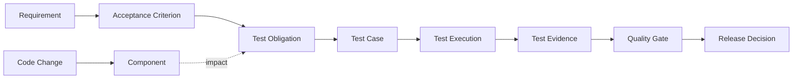
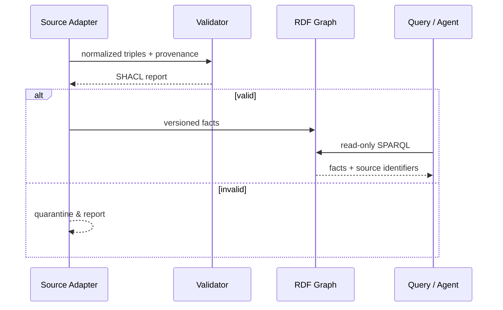

# 系统与本体架构

## 总体设计


## 分层架构
```mermaid
flowchart TB
 subgraph Sources[External Sources - optional]
 GH[Git / PR] CI[CI Results] REQ[Requirements] TEST[Test Reports]
 end
 subgraph Semantic[Semantic Layer]
 MAP[Adapters & Identity Mapping] CORE[Core Ontology] SDLC[SDLC Ontology] QE[QE Ontology] SH[SHACL] PROV[Provenance]
 end
 subgraph Consumers[Consumers]
 Q[SPARQL Queries] CLI[Local CLI] AG[Read-only Agent Tool]
 end
 GH & CI & REQ & TEST --> MAP
 MAP --> CORE
 CORE --> SDLC & QE
 SDLC & QE --> SH & PROV
 SH & PROV --> Q & CLI & AG
```

## 设计决策
- core 只包含跨域稳定抽象，避免“万能实体”失去语义。
- sdlc 与 qe 通过 alignment 关系连接，避免双向循环依赖。
- 概念 URI 与实体 URI 分离；跨工具身份映射须保留来源与置信度。
- 原始事实、人工判断、推理结果分别标记来源。
- SHACL 负责数据形状验证；OWL 负责逻辑语义；程序规则负责复杂时间/计算约束。
- 查询输出必须能追溯到源记录和快照版本。

## 数据流程


## 安全与边界
适配器不默认连接客户系统；敏感字段脱敏；只读 Agent；SPARQL 查询资源限制；输入验证；查询结果标注时间与来源；禁止未经审批的自动发布操作。

## 兼容策略
新增概念通常可兼容；删除/重命名 URI、改变 domain/range 或关系语义需重大版本评审。每次变更必须运行旧样本和查询回归。
