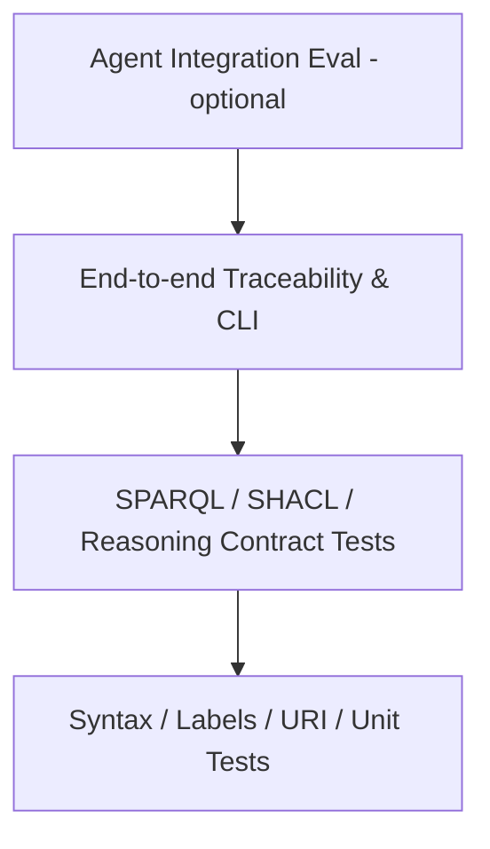

# TDD、质量门禁与 Eval 设计

## 测试金字塔

## TDD 顺序
红：先写反例或失败断言；绿：最小化修改本体或实现；重构：统一命名与抽象；回归：重跑全部样例与旧版查询。

## 测试矩阵
| 类型 | 输入 | 预期 |
|---|---|---|
| 解析 | 合法/非法 TTL | 正确解析/拒绝 |
| SHACL | 完整/缺失证据 | 通过/明确 violation |
| 推理 | 类包含和实例 | 仅推导合法结论 |
| 查询 | 人工标注关系 | 返回精确实体与来源 |
| 兼容 | 上一版本样本 | 旧查询保持契约或明确迁移 |
| 安全 | 恶意查询/外部 URL | 限制访问、超时和副作用 |
| 文档 | 链接与代码示例 | 路径存在且可复现 |

## 评估指标
- 变更影响召回率 = 命中真实受影响项 / 所有真实受影响项。
- 影响建议精确率 = 正确影响建议 / 所有影响建议。
- 证据可追溯率 = 有可核验来源的结论 / 全部结论。
- 约束检测准确性：正例通过率与反例检出率分开报告。
- 成本：模型维护工时、执行时延、Agent token/工具调用。

## 对照组
A 纯规则/普通数据关联；B 普通 LLM 或 RAG；C 本体增强。使用同一批人工标注样本；区分推理、检索和验证的贡献；不凭示例成功推断总体收益。

## 初期 Gate
P0 解析和契约测试 100% 通过；SHACL 正反例符合预期；无高危安全问题；人工标注样本无未解释的关键遗漏。性能与准确率阈值需先用基线实验确定，不随意宣称目标已达成。
