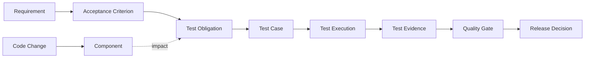

# 最小模型示例（概念性）



## Turtle 片段（示意，非已验证发布本体）
```turtle
@prefix ex: <https://example.org/sdlc-qe/> .
@prefix rdf: <http://www.w3.org/1999/02/22-rdf-syntax-ns#> .
@prefix rdfs: <http://www.w3.org/2000/01/rdf-schema#> .

ex:Requirement a rdfs:Class .
ex:TestObligation a rdfs:Class .
ex:derivedFrom a rdf:Property ;
  rdfs:domain ex:TestObligation ;
  rdfs:range ex:Requirement .
ex:req-001 a ex:Requirement .
ex:obligation-001 a ex:TestObligation ; ex:derivedFrom ex:req-001 .
```

## 查询片段
```sparql
PREFIX ex: <https://example.org/sdlc-qe/>
SELECT ?obligation ?requirement WHERE {
  ?obligation a ex:TestObligation ; ex:derivedFrom ?requirement .
}
```

## 解释
这是演示关系表达的最小样例。正式项目需要采用稳定的项目命名空间、版本、术语定义、双语标签和 SHACL 约束。
