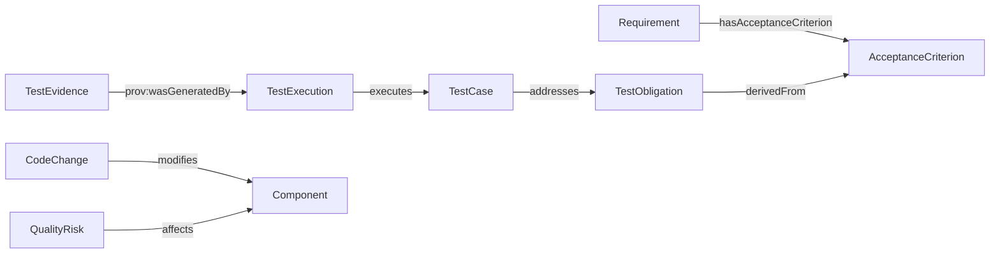

# 本体契约与能力问题（Competency Questions）v0.2

## 1. 命名与版本

- 项目名 `sdlc-qe-ontology`；正式 namespace/IRI **待确认域名所有权后确定**，不可直接将 GitHub URL 当作稳定的本体 IRI 承诺。
- 模块 `core`、`sdlc`、`qe`、`mappings`；命名英文 PascalCase 类、camelCase 属性，双语 `rdfs:label`。
- `owl:versionIRI` 标记发布版本；破坏性语义修改走 Major；新增兼容术语走 Minor；注释修正走 Patch。
- 明确 `deprecated`、替代术语、迁移说明、旧查询兼容窗口。

## 2. 关键概念候选

| 类 | 定义（简写） | 所属 | 重要边界 |
|---|---|---|---|
| Requirement | 描述预期行为或约束的研发资产 | SDLC | 不等于 AcceptanceCriterion |
| CodeChange | 代码版本之间的变更实体 | SDLC | PR 是评审/合并容器，不等于 Commit |
| Build | 构建活动/结果需区分 | SDLC | 活动和产物不可混为一个类 |
| Release | 计划或交付的版本单元 | SDLC | 与 Deployment 分离 |
| TestObligation | 某项声明需要满足的验证责任 | QE | 不等于 TestCase |
| TestCase | 可执行或人工验证设计 | QE | 不等于 TestExecution |
| TestExecution | 一次实际执行活动 | QE | 关联具体版本、环境、时间 |
| TestEvidence | 可追溯的验证材料 | QE | 存在不代表充分或可信 |
| QualityClaim | 可被证据支持或反驳的质量声明 | QE | 不等于自动成立的事实 |
| QualityRisk | 不确定性及其质量影响 | QE | 风险分值是策略，不是 OWL 逻辑 |

## 3. 关系候选与语义约束

| 关系 | Subject → Object | 说明 |
|---|---|---|
| hasAcceptanceCriterion | Requirement → AcceptanceCriterion | 验收条件关联 |
| derivedFrom | TestObligation → AcceptanceCriterion | 义务来源 |
| addresses | TestCase → TestObligation | 测试设计尝试覆盖义务 |
| executes | TestExecution → TestCase | 实际执行的测试设计 |
| modifies | CodeChange → Component | 静态/人工映射，可能不完整 |
| supportsClaim | TestEvidence → QualityClaim | 仅表达支持关系，不表示证据充分 |
| affects | QualityRisk → Component | 风险影响对象 |

## 4. 能力问题与验收查询

| ID | 问题 | 所需数据 | 可测试断言 |
|---|---|---|---|
| CQ-01 | 某需求有哪些验收标准？ | Requirement, AcceptanceCriterion | 返回标注集合 |
| CQ-02 | 某标准有哪些测试义务未被任何测试设计覆盖？ | Criterion, Obligation, Case | 不漏标注义务 |
| CQ-03 | 某 PR 可能影响哪些组件及测试？ | Change, Component, Test | 输出影响路径及来源 |
| CQ-04 | 某测试证据由哪个执行产生？ | Execution, Evidence, PROV | 可回溯执行 ID、时间、版本 |
| CQ-05 | 哪些质量声明缺少有效证据？ | Claim, Evidence, Policy | 规则判定结果可复现 |
| CQ-06 | 某发布有哪些未关闭风险？ | Release, Risk, Gate | 明确规则阈值来源 |

## 5. 推理与验证分界

- OWL：`SubClassOf` 等公理推理，采用开放世界假设；缺失字段**不能直接**判定为错误。
- SHACL：检查实例数据必填项、格式、目标类型和数据完整性；验证范围和严重性必须定义。
- 应用规则：证据是否充分、发布是否通过、影响路径是否可信，通常是**版本化业务策略**，不假定 OWL 自动解决。

## 6. Mermaid 关系草图

**注意**：该图是语义草案，不代表所有 RDF 断言已经存在；PROV 映射需要 TestExecution 被建模为 `prov:Activity`。
