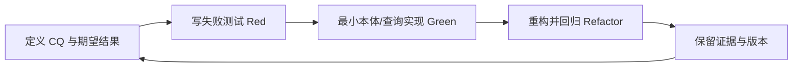

# 技术 Spike、TDD 与 Eval 计划 v0.2

## 1. 实验矩阵

| Spike | 目标 | 输入 | 通过条件 | 失败后处理 |
|---|---|---|---|---|
| S01 标准映射 | OSLC / PROV-O 语义对齐 | 术语清单 | 每个映射有 URI、依据、冲突记录 | 缩小映射范围 |
| S02 模型解析 | Turtle/OWL 解析 | 最小本体文件 | CI 稳定解析；IRI 不冲突 | 修正契约 |
| S03 约束验证 | SHACL 正反样本 | 合法/缺陷数据 | 正样本通过、每类负样本触发预期错误 | 修正规则或数据 |
| S04 查询 | CQ-01~06 | 人工标注小数据 | 结果与标注逐项核对 | 调整模型/查询 |
| S05 推理 | 子类及属性推理 | 最小公理数据 | 预期推论正确；不推出错误关系 | 限制推理范围 |
| S06 对照实验 | 本体价值 | 相同输入与预算 | 报告召回/精确率/成本；不要求预设胜出 | 如无增益降低复杂度 |

## 2. TDD 循环

每个术语和关系变更必须附带：正样本、负样本、能力问题、SPARQL 查询或 SHACL shape、兼容性说明。

## 3. 数据集设计

- `golden-small`：10 个需求、5 个 PR、30 个测试设计、10 个证据对象；**目标数量，非已存在数据**。
- `negative-cases`：缺失必填字段、关系指向错误、证据版本不一致、悬空引用、重复外部 ID。
- `counterfactual`：修改组件与需求映射、移除执行证据，观察报告是否相应改变。
- 人工标注必须有审查者、时间、争议处理记录；训练/提示词调优与测试集分离。

## 4. 度量

| 指标 | 定义 | 注意 |
|---|---|---|
| Impact Recall | TP/(TP+FN) | 漏报影响路径成本高 |
| Impact Precision | TP/(TP+FP) | 避免大量无用建议 |
| Evidence Traceability | 可回溯证据数/报告引用证据数 | 分母为 0 时记 N/A |
| SHACL Detection | 被正确检出的预设违规数/总预设违规数 | 按规则类别拆分 |
| Query Correctness | 与 gold 集一致的 CQ 结果比例 | 区分空结果与错误 |
| Cost / Latency | 执行时间、内存、模型费用 | 同硬件/同预算比较 |

## 5. CI 质量门禁

- P0：Turtle/OWL 解析、IRI 唯一性、SHACL 正反样本、CQ 回归、依赖许可证审查。
- P1：本体 diff 检查、语义版本兼容、文档/图示同步、跨平台测试。
- P2：Agent 输出 Eval、扩展数据规模性能、外部工具适配。

## 6. Go / No-Go

**Go（进入 v0.1）**：S01~S04 完成且有可复现证据，阻断性许可问题清零，ADR-001~004 获批准。**No-Go**：存在无解释的语义冲突、负样本误通过、核心查询不能复现、外部依赖许可证不明。
