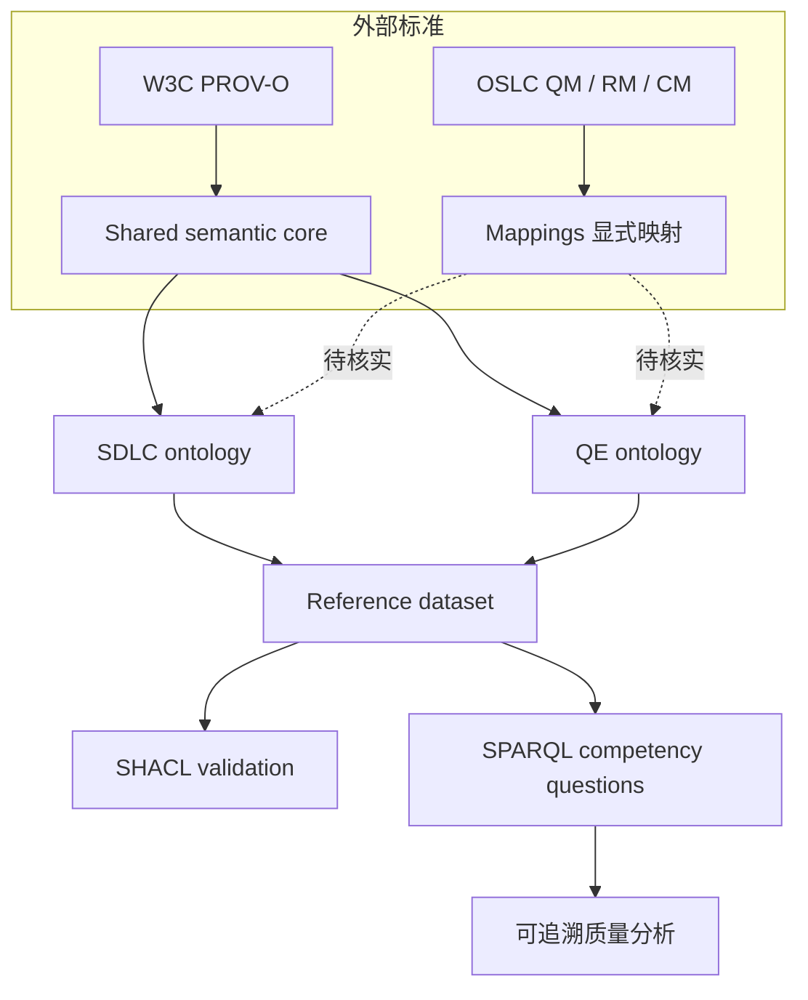

# SDLC-QE Ontology v0.3 候选架构评审

> 状态：**候选（Candidate），尚未获项目所有者批准**。本包提供可运行的 S02 / S04 局部验证；不宣称 S01、S03、S05、S06 完成。

## 1. 范围冻结建议

| 范围 | v0.1 候选 | 排除范围 |
|---|---|---|
| Shared Core | Resource, Component（暂由 SDLC 模块定义），统一标识和双语标签 | 通用企业业务本体 |
| SDLC | Requirement, AcceptanceCriterion, CodeChange, Component, PullRequest | 全量项目管理平台 |
| QE | TestObligation, TestCase, TestExecution, TestEvidence, QualityClaim | 以 OWL 自动裁决质量是否充分 |
| Provenance | TestExecution `rdfs:subClassOf prov:Activity`；证据 `prov:wasGeneratedBy` | 自动判定证据可信度 |
| 查询 | CQ-01/02/03/04 最小样例；CQ-05/06 设计保留 | 完整发布策略引擎 |

## 2. 重要建模决策

1. `TestObligation` 是应验证的责任，不等于 `TestCase`；未被 `addresses` 关联不自动说明真实世界中不存在测试。
2. `TestExecution` 表示一次执行活动，不混用 `TestResult`（结果记录）与 `BuildArtifact`（制品）。
3. `TestEvidence` 是具有来源的记录，不代表“有效”“充分”或“通过”。
4. 对 `CodeChange → Component → TestCase` 的路径仅输出**潜在影响**，不可宣称已证明影响。
5. 采用开放世界 OWL 语义；闭世界数据完整性检查交由 SHACL / 应用规则。
6. 示例 namespace `https://example.org/sdlc-qe/` **仅用于实验**；正式稳定 IRI 必须有域名控制权和解析策略。

## 3. 候选架构

## 4. Go/No-Go 状态

| 门禁 | 当前证据 | 结论 |
|---|---|---|
| S01 OSLC / PROV-O 术语精确映射 | 仅有映射工作表，未逐条完成 URI 及语义复核 | BLOCKED |
| S02 RDF/Turtle 解析 | `tests/test_baseline.py` 可运行 | PARTIAL PASS |
| S03 SHACL 正反数据 | shapes 与正反样例已提供；环境未安装 pySHACL | NOT VERIFIED |
| S04 CQ-01~06 | CQ-01~04 的部分路径有自动化测试；CQ-05/06 未实现 | PARTIAL PASS |
| S05 OWL 推理 | 未执行 | NOT VERIFIED |
| S06 本体增益对照实验 | 未执行 | NOT VERIFIED |
| 许可证审查 | 需逐个确认依赖和复用本体的授权及再发布条款 | BLOCKED |

**结论：仅允许继续技术 Spike，不批准 v0.1 全量实施启动。**
