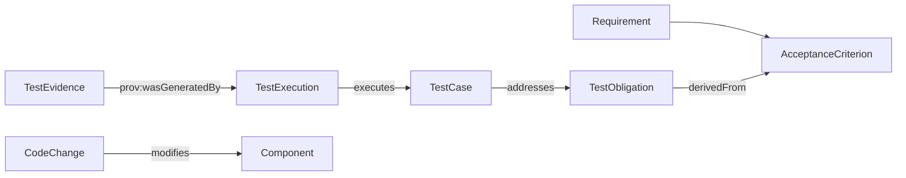

# v0.7 端到端语义 Spike 与证据

## 目标与范围
新增一组通用软件交付数据，不引入特定业务本体。验证两个独立能力问题：CQ-05 未被测试用例覆盖的测试义务；CQ-06 测试证据的执行来源。数据使用现有命名空间 `https://example.org/sdlc-qe/`，仅为实验标识符，不是正式发布 URI。

## 金标与预期
| 数据集 | CQ-05 缺口 | CQ-06 来源链 | 解释 |
|---|---|---|---|
| delivery-flow.ttl | 0 | 1 | 已关联测试与执行证据，但不代表测试通过或证据充分 |
| delivery-gap.ttl | 1 | 0 | 存在测试义务但没有已知测试用例；开放世界假设下只能称为当前数据集的关联缺口 |

## 关键限制
- 此处“端到端”指 Requirement→Criterion→Obligation→TestCase→Execution→Evidence 的语义链；**尚未包含真实 PR、Build、Release 资源**。
- `CodeChange→Component` 为单独的关系，**尚未与 Requirement 或 TestObligation 建立经验证的影响路径**。
- SPARQL `FILTER NOT EXISTS` 属于闭合数据集上的查询判断，不等价于 OWL 的逻辑否定。
- 证据链存在不代表测试通过、断言有效或质量声明成立。
- SHACL 仍需在 pySHACL 可用的环境运行；不可用时保持 No-Go。

## 执行
`python -m unittest discover -s tests -v`，以及 `python scripts/verify_baseline.py`。结果见 `evidence/unittest-v07.txt` 与 `evidence/strict-gate-v07.txt`。
