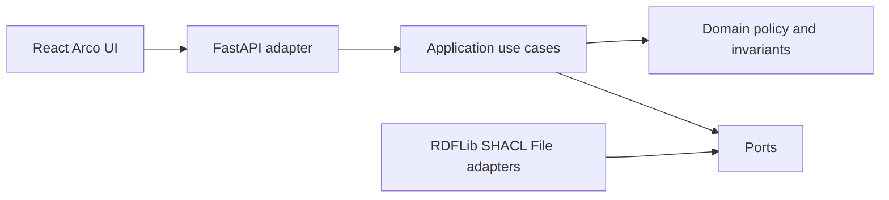

# 架构与模块边界

## 基线
- 前端 React + TypeScript + Vite + Arco Design React（组件集成须验证）；React Router、组件与 API 调用分离。
- 后端 Python + FastAPI + Pydantic，底层 RDFLib/SPARQL 与 pySHACL。Local-first：仅 loopback 服务，无默认远程同步，无默认用户身份系统或 MySQL/JWT。
- 领域规则 (`domain/`) 不能依赖 FastAPI、文件系统、Arco 或 HTTP；`adapters/` 负责文件、RDFLib 和 API 转换；`application/` 编排用例、确认门禁和快照提交。

## 依赖与写操作
- 本体定义在 `ontology/`；禁止 UI 直接修改 RDF 三元组或直接查询文件系统。
- 导入是受约束的写入工作区操作，不代表对外平台拥有写权限。
- 快照一经发布不可变；新版本须先在隔离副本验证，再原子替换活动指针。
- 规则计算状态、数据完整性与保证状态应独立暴露；`Unknown` 不可转化成绿色通过。
- v0.18 API 契约及之前 schema 为候选，合并前必须通过契约一致性检查。
