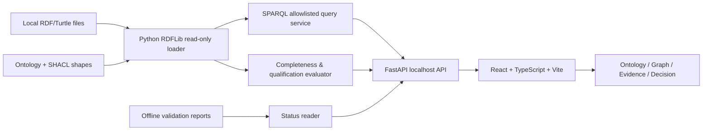

# Architecture & Stack / 架构与技术栈

## 推荐技术栈
- **Backend** Python 3.12+、RDFLib（与 v0.10 现有代码衔接）、FastAPI、Pydantic v2、pytest。pySHACL 用于独立验证任务，不在缺失时悄悄跳过。
- **Frontend** React 19 + TypeScript + Vite；TanStack Query（只读缓存）；React Router；React Flow 或 Cytoscape.js（两者选其一，先做渲染 Spike）；Vitest + Testing Library；Playwright E2E。
- **样式** CSS variables + 轻量组件库（如 shadcn/ui）；中英文资源文件，英文默认；键盘操作与可访问性优先。
- **存储** MVP 不引入 SQLite/PostgreSQL。读取本地固定目录的 RDF、查询结果和验证报告；后续如需缓存再单独 ADR。
- **部署** 本地启动 `127.0.0.1` 后端和开发 UI；发布时静态前端由后端同源提供，避免默认暴露局域网服务。

## 数据流与一致性
1. 读取受控数据集，生成 SHA-256 snapshot ID；不修改源文件。
2. RDF 解析失败 → API 明确 error，UI 显示 unavailable/Unknown，不复用旧绿色状态。
3. 执行固定 allowlist SPARQL 查询 + 完整性检查 + 资格策略。
4. 统一输出 assessment status、reason codes、source triple references、ruleset version、snapshot ID、evaluatedAt。
5. 图谱与详情读取同一快照；切换快照清空相关缓存。

## 安全边界
- 默认只监听 loopback，禁止任意远程 URL 载入和任意 SPARQL UPDATE。
- 固定输入目录；拒绝目录穿越、符号链接逃逸、超大文件和恶意查询；限制图谱节点/边、请求大小和执行时长。
- API 默认只读 GET；禁止在 UI 中执行系统命令。
- `evidenceDigest` 仅表示字段存在，不代表已完成真实性/完整性校验。
- CSP、HTML 转义、受控本地文件访问；避免将用户路径、秘密和完整原始数据写入日志。

## 兼容策略
现有 `01_project/ontology/baseline.ttl`、`queries/*.rq`、`shapes/*.ttl` 原样保留。新增 API adapter 只读取数据，所有新增规则在单独版本化 policy 中实现；旧 CQ-10 仅用于对照和回归，不直接决定 UI 质量状态。实验命名空间 `example.org` 不作为生产稳定 IRI。
