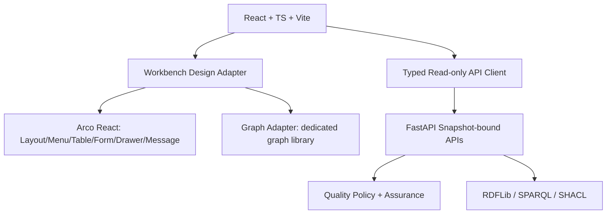

# Arco-based UI architecture

## Design adapter
`src/ui/` exports `AppShell`, `PageHeader`, `StatusTag`, `EvidenceTable`, `DetailDrawer`, `EmptyState`, `ErrorState`, `VersionInfo`, `ThemeSwitcher`. Business pages import the adapter, not Arco internals directly. Do not build a second design system.

## Page mapping
| Page | Primary components | Notes |
|---|---|---|
| Overview | Layout, Grid, Card, Statistic, Alert | No fabricated metrics; snapshot and assurance shown |
| Ontology Explorer | Input, Tree, Table, Descriptions, Drawer | IRI is selectable/copyable; bilingual labels |
| Relationship Graph | Graph library, Card, Drawer, Select | Node cap, list fallback, keyboard selection |
| Evidence Explorer | Table, Tabs, Tag, Drawer, Pagination | Status and provenance visible; snapshot fixed |
| Quality Decision | Alert, Descriptions, Table, Timeline | Distinguish assessment and assurance; never claim Go |
| Validation Status | Result, Table, Alert | SHACL unavailable displayed as unavailable/blocked |
| Settings | Radio/Select/Switch, Descriptions | theme: light/dark/system; locale: en/zh-CN/system; versions read-only |

## Interface invariants
- A page and all its child requests use the same immutable `snapshotId`; on snapshot change invalidate all related queries atomically.
- UI never derives Qualified from table row counts or absence of errors.
- Quality assessment, assurance, reason codes and provenance are supplied by the backend contract.
- API errors and unknown fields cannot silently render as Qualified.
- Graph color is secondary to textual label, icon, and accessible description.
